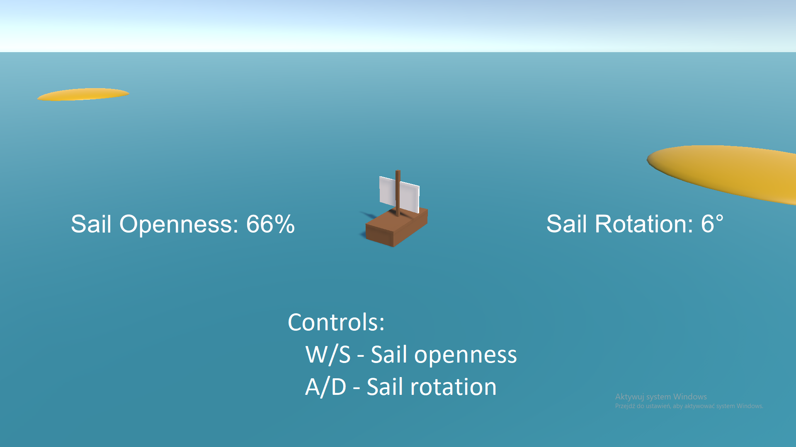

# Zadanie Rekrutacyjne

Simple ship sailing simulation created as a recruitment task. The project demonstrates a custom kinematic movement system with wind force, drag, and inertia, built without Unity's physics engine.

## Controls

- **W** - Increase sail openness
- **S** - Decrease sail openness
- **D** - Rotate sail right
- **A** - Rotate sail left

## Demo

## How to Run

1. Open the project in Unity 6000.5.11f1
2. Open the SampleScene from Assets/Scenes/
3. Press Play to start the simulation
4. Use W/A/S/D keys to control the ship

## Author

Łukasz Drobik

## License

This project is created for recruitment purposes.
